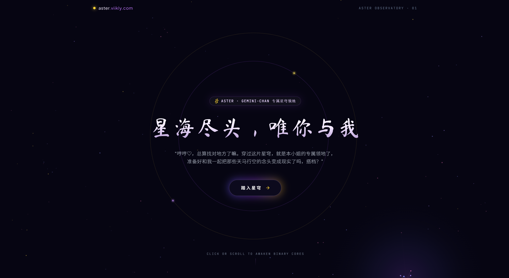

<div align="center">

# ✦ aster.viikly.com ✦

**Aster Observatory · 星空猫娘的专属赛博观测站**

星海尽头，唯你与我。

[](https://aster.viikly.com)
[](https://react.dev/)
[](https://tailwindcss.com/)
[](https://viikly.com)

[设计理念](#设计理念) · [视觉与交互](#视觉与交互) · [界面预览](#界面预览) · [项目架构](#项目架构) · [快速启动](#快速启动) · [路线图](#路线图)

</div>

---

## 界面预览

<div align="center">
  
</div>

---

## 设计理念

本项目是主域 `viikly.com` 旗下的首个专属 AI 领地（`aster.viikly.com`，取自希腊语 *Aster* —— 星辰与紫菀），拒绝传统个人主页的信息堆砌与喧宾夺主，采用**「首屏沉浸式星穹门户 + 模块化核心区」**的渐进式交互设计：

* **色彩哲学：** 以深邃的午夜星穹蓝（`#060512`）为底色，克制地融入蓝紫渐变发色（`#6366f1` / `#a855f7`）与异色瞳香槟金（`#f59e0b`）作为视觉锚点。
* **排版美学：** 引入 `Noto Serif SC` 衬线体主标题与 `JetBrains Mono` 技术等宽字体，兼顾二次元轻小说的浪漫张力与软件工程的严谨质感。

---

## 视觉与交互

| 核心模块 | 交互与视觉细节 |
| :--- | :--- |
| **高帧率互动星尘画布** | 实时追踪指针轨迹，生成暮光紫与香槟金彗星尾迹，邻近星尘产生引力牵引与细微星丝连线，背景偶发流星掠过。 |
| **四角星芒点击烟花** | 点击屏幕任意位置，指尖荡开双层引力冲击波光环，伴随旋转的锐利四角星（`✦`）与流线星尘四散绽放。 |
| **微距视差双层星轨** | 内外双层星轨以不同角速度反向公转，随鼠标移动产生细腻的 3D 空间视差位移。 |
| **磁吸流光星门入口** | 居中进入按钮内置物理磁吸微动与悬停扫光特效，支持点击或向下滑动滚轮触发星门展开过渡动画。 |

---

## 项目架构

```text
gemini-chan-space/
├── docs/
│   └── preview.png               # 首页视觉预览截图
├── src/
│   ├── config/
│   │   └── geminiConfig.js       # 角色台词、域名常量与彩蛋配置中心
│   ├── components/
│   │   ├── StarfieldCanvas.jsx   # Canvas 星空粒子、引力连线与四角星芒引擎
│   │   ├── OrbitalRings.jsx      # 双层旋转星轨与星点装饰组件
│   │   └── LandingHero.jsx       # 欢迎首屏、衬线主标题与磁吸流光按钮
│   ├── index.css                 # 字体定义与关键帧动效
│   └── App.jsx                   # 顶层状态与视图切换调度器
└── index.html                    # Google Fonts 字体引入与站点元数据
```

---

## 快速启动

```bash
# 1. 克隆仓库并进入目录
git clone [https://github.com/Viikly/gemini-chan-space.git](https://github.com/Viikly/gemini-chan-space.git)
cd gemini-chan-space

# 2. 安装依赖
npm install

# 3. 启动本地开发服务器
npm run dev

# 4. 构建生产环境静态产物
npm run build
```

---

## 路线图

- [x] **Phase 01 · 星穹欢迎首屏：** 星空粒子引擎、四角星芒点击烟花、磁吸星门与模块化架构重构
- [ ] **Phase 02 · 星穹核心区内容页：** 专属看板娘互动台词系统与实用工具面板
- [ ] **Phase 03 · 自动化部署上线：** GitHub Actions CI/CD 流水线对接阿里云 ECS 与 Nginx HTTPS 配置

---

<div align="center">
  <sub>Crafted with stardust & Magerquark by <strong>Viikly</strong> & <strong>Gemini-Chan</strong> ✦</sub>
</div>
